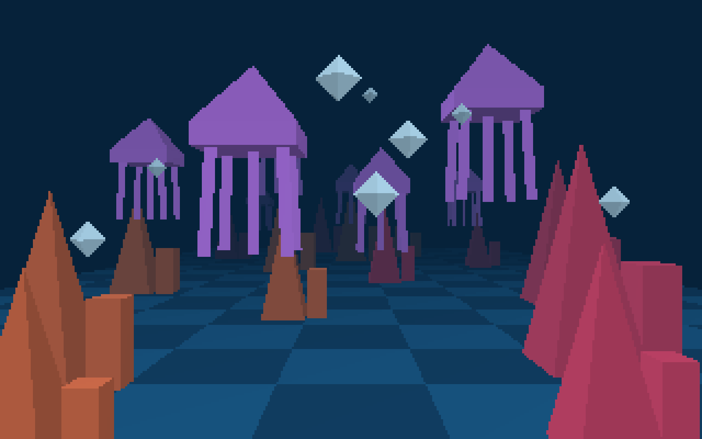
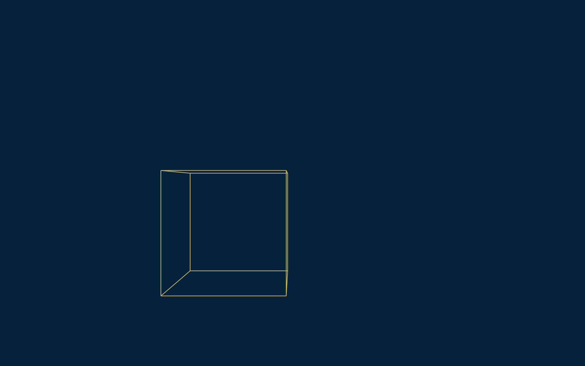
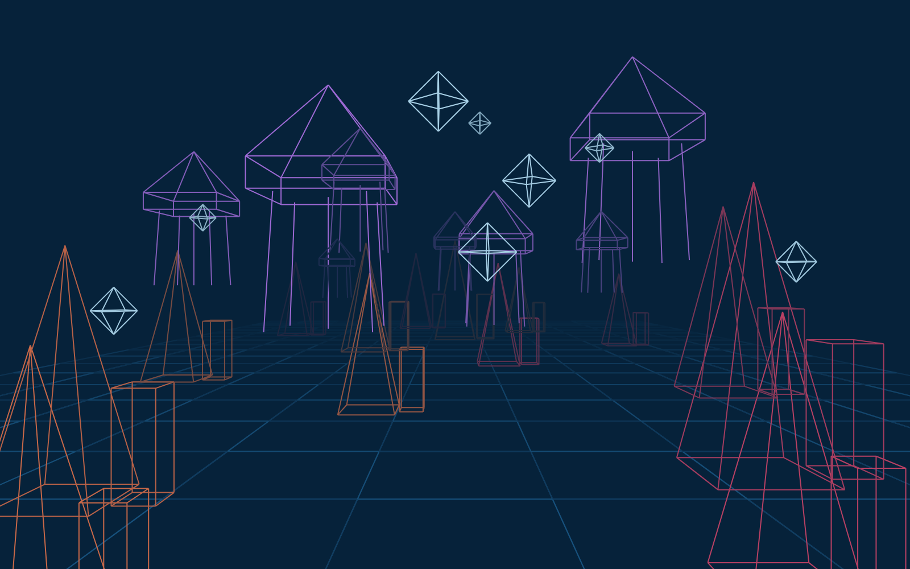
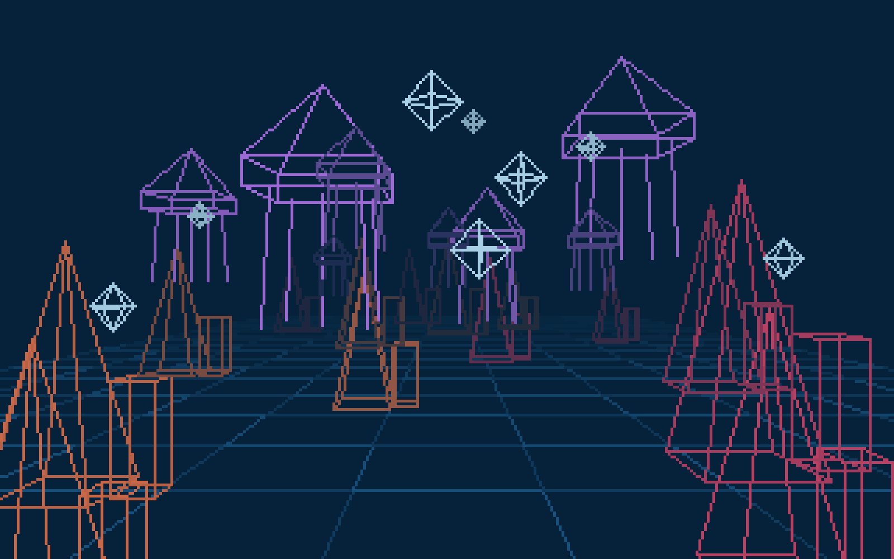
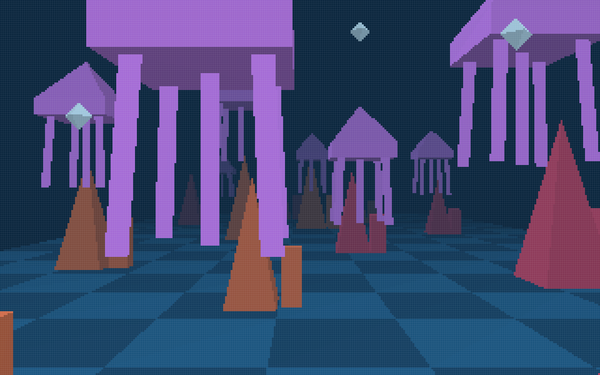
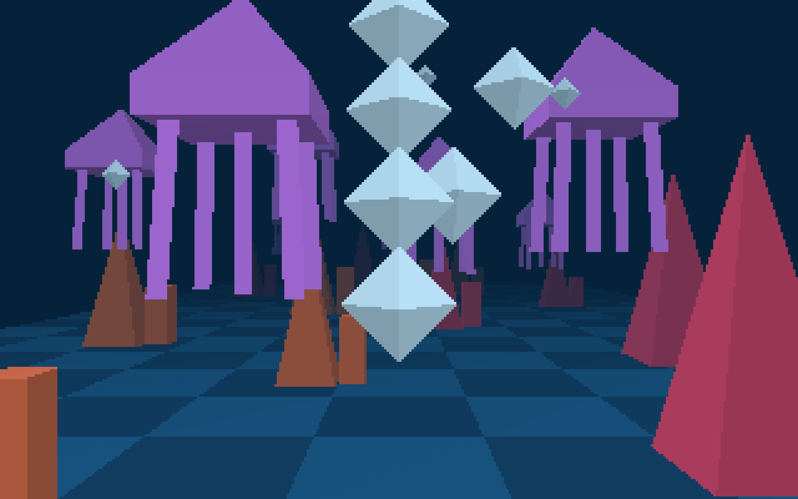

# Deep-Sea Descent

A small underwater scene you can swim through, drawn entirely with my own rendering code on an HTML canvas. No WebGL, no graphics libraries.

**Play it here:** https://pratham-2097.github.io/deep-sea-descent/  
**Documentation:** https://pratham-2097.github.io/deep-sea-descent/docs.html  
**Demo video:** https://www.youtube.com/watch?v=JwJnZu6r0iY

Computer Graphics I, Project 1 (pinhole camera, rasterized display) · Pratham Prabhu

## Levels

Press `0`–`3` (or use the buttons above the screen) to switch between them.

| Level | What you see |
|---|---|
| 0 | A wireframe cube you can move around |
| 1 | The full scene as a wireframe, drawn with the canvas line function on a 1600 x 1000 canvas |
| 2 | The same scene on a 320 x 200 low-res display, using my own line drawing |
| 3 | Filled triangles on the 320 x 200 display, with a depth buffer so closer things cover farther ones |

| Level 0 | Level 1 |
|---|---|
|  |  |

| Level 2 | Level 3 |
|---|---|
|  |  |

Up close with the pixel grid turned on (`G`), and a trail of released bubbles (`Space`):

| Pixel grid | Bubbles |
|---|---|
|  |  |

## Controls

| Key | Action |
|---|---|
| Arrow keys | Move left / right / forward / back |
| Q / E | Sink / rise |
| Space | Release a bubble |
| R | Reset the scene and camera |
| 0 / 1 / 2 / 3 | Switch level |
| G | Show or hide the pixel grid (levels 2 and 3) |

## What's in the scene

Four object types, each modeled once at the origin and then placed as instances with their own position, scale and color:

- **Jellyfish:** a slab and pyramid for the bell, with five tentacles
- **Coral:** a tall pyramid with a box beside it
- **Bubbles:** a diamond (octahedron)
- **Seafloor tiles:** a checkerboard of flat squares

## How it works

Everything lives in `index.html`. The three functions that do the real work:

- `project()`: the pinhole camera. Subtracts the camera position, divides by depth (`u = x / z`, `v = y / z`), then scales to the screen.
- `drawLine()`: incremental line drawing for level 2. Handles every slope by swapping endpoints and stepping by rows for steep lines.
- `fillTriangle()`: level 3. Checks each pixel in the triangle's bounding box with barycentric coordinates and keeps the closest one using a depth buffer.

## Running it locally

Just open `index.html` in a browser. There's nothing to install.
